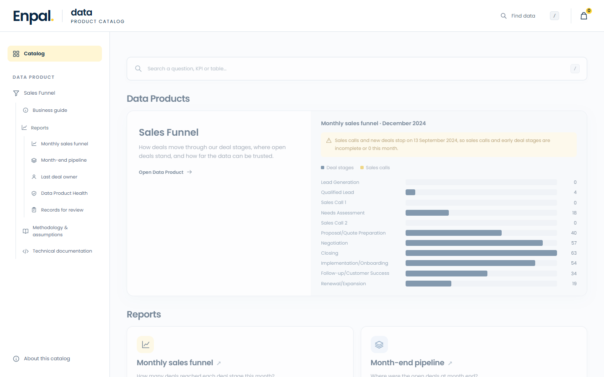

# Monthly sales funnel from Pipedrive

A dbt and Postgres project that turns a Pipedrive export into `rep_sales_funnel_monthly`: how many deals entered each funnel step, month by month.

## Top-level Overview

The report counts movement: how many deals entered each step per month. A deal that jumps from stage 2 to 5 counts in 3, 4 and 5, because it got past them. A sales call counts if it was completed, in the month it was due. A deal counts once per step per month.

**Example:** a deal enters stage 1 in May, stage 3 in June, stages 4 and 6 in July and stage 7 in August, and is lost in August.

| | May | Jun | Jul | Aug |
|---|---|---|---|---|
| `rep_sales_funnel_monthly` | 1 | 2, 3 | 4, 5, 6 | 7 |
| `rep_deal_stage_distribution_monthly` | 1 | 3 | 6 | None |

| Reading | Counts | Why it's not the main report |
|---|---|---|
| **Every stage entered, skips included** | Movement | This is the main report |
| Only recorded stage changes | Stage rows | Misses skipped stages |
| Only a deal's last stage each month | One stage per deal and month | Misses stages it passed through |
| Month-end deal / stage distribution | Position | A different question, so it has its own report |

## Data Product Catalog

The [Data Product Catalog](catalog/index.html) is the consumer view of this project: the Sales Funnel Data Product and its five Reports, with their purpose, use cases, data, definitions and technical detail. Request access makes a local draft only.

Open `catalog/index.html` from a clone or the zip. It needs no server or database, and GitHub shows only its source code.



## Run it

You need Docker Desktop and Python. Tested on Python 3.12.

```bash
python -m venv .venv
source .venv/bin/activate         # Windows: .venv\Scripts\activate
pip install -r requirements.txt

docker compose run --rm data_loader && dbt build
```

That last line starts Postgres, loads the data, and runs dbt only if the load succeeded. On Windows PowerShell 5.1, which has no `&&`, run the two commands one at a time and start `dbt build` only if the loader ends with `Data loading completed.`

**What you should see:** `dbt build` ends with `PASS=181 WARN=5 ERROR=0`. The five warnings are known oddities in this data, and they're listed in `docs/technical_documentation.md`. The reports are in the schema `public_pipedrive_analytics`.

**To reload,** run the last line again. All tables are replaced in one transaction, so loading twice changes nothing and a failed load keeps the previous data. `docker compose up -d` loads too, but in the background, so dbt can't wait for it.

**To stop and delete the database:** `docker compose down -v`.

## How it's built

```
raw tables -> ods_ -> core (dim_, fct_) -> rep_
```

| Layer | What it does |
|---|---|
| `ods_` | Cleans each source table: data types, names, exact duplicates. No business rules |
| core | Holds the business data, ready for analysis. Broken records are flagged here, and the movement and position logic live here |
| `rep_` | Three output reports and two data quality reports |

## Key assumptions

The five that move the numbers. All of them, with the alternatives not chosen, are in `docs/methodology_and_assumptions.md`. The effect of each is in the sensitivity table in `docs/technical_documentation.md`.

| Assumption | Why | Effect |
|---|---|---|
| Sales calls are part of a deal's progress, and each step is counted on its own | The requirements place them between stages, and too few deal IDs match between calls and stages to rely on | Call counts can't be tied to stage counts |
| A deal counts in every stage it reached, even ones it skipped | It got past them | Stage steps are higher than recorded stage changes |
| A call counts only if completed, in the month it was due | A call that didn't happen shouldn't count, and the data doesn't show when calls were held | Call steps are lower than all scheduled calls |
| Records with a broken ID are excluded and listed | Nothing shows which of the conflicting records is right | Stage and call steps are slightly lower |
| Lead Generation is dated by the recorded entry into stage 1 | This data doesn't capture a deal's first stage at creation | Lead Generation falls later than deal creation |

## Documents

| Document | For |
|---|---|
| [Data Product Catalog](catalog/index.html) | Consumers: the Data Product and its Reports |
| [Methodology and assumptions](docs/methodology_and_assumptions.md) | Reviewers: what was built, what was assumed, and why |
| [Business guide](docs/business_guide.md) | Business users: what the reports mean and how to use them |
| [Technical documentation](docs/technical_documentation.md) | Engineers: models, tests, results and the sensitivity table |
| [Exploratory analysis notebook](analyses/exploratory_analysis.ipynb) | Questions, saved SQL, captured results, interpretations and modeling decisions |
| [`analyses/sql/`](analyses/sql/) | Saved SQL queries behind the notebook and documented findings |

Layer notes are in [`models/ods/`](models/ods/README.md), [`models/core/`](models/core/README.md) and [`models/reporting/`](models/reporting/README.md). `dbt docs generate && dbt docs serve` shows the lineage.

# Assignment

## Setup

1. Download Docker Desktop (if you don’t have installed) using the official website, install and launch.
2. Fork this Github project to you Github account. Clone the forked repo to your device.
3. Open your Command Prompt or Terminal, navigate to that folder, and run the command `docker compose up`.
4. Now you have launched a local Postgres database with the following credentials:
 ```
    Host: localhost
    User: admin
    Password: admin
    Port: 5432 
```
5. Connect to the db via a preferred tool (e.g. DataGrip, Dbeaver etc)
6. Install dbt-core and dbt-postgres using pip (if you don’t have) on your preferred environment.
7. Now you can run `dbt run` with the test model and check public_pipedrive_analytics schema to see the dbt result (with one test model)

## Project
1. Remove the test model once you make sure it works
2. Dive deep into the Pipedrive CRM source data to gain a thorough understanding of all its details. (You may also research the Pipedrive CRM tool terms).
3. Define DBT sources and build the necessary layers organizing the data flow for optimal relevance and maintainability.
4. Build a reporting model (rep_sales_funnel_monthly) with monthly intervals, incorporating the following funnel steps (KPIs):  
  &nbsp;&nbsp;&nbsp;Step 1: Lead Generation  
  &nbsp;&nbsp;&nbsp;Step 2: Qualified Lead  
  &nbsp;&nbsp;&nbsp;&nbsp;&nbsp;&nbsp;Step 2.1: Sales Call 1  
  &nbsp;&nbsp;&nbsp;Step 3: Needs Assessment  
  &nbsp;&nbsp;&nbsp;&nbsp;&nbsp;&nbsp;Step 3.1: Sales Call 2  
  &nbsp;&nbsp;&nbsp;Step 4: Proposal/Quote Preparation  
  &nbsp;&nbsp;&nbsp;Step 5: Negotiation  
  &nbsp;&nbsp;&nbsp;Step 6: Closing  
  &nbsp;&nbsp;&nbsp;Step 7: Implementation/Onboarding  
  &nbsp;&nbsp;&nbsp;Step 8: Follow-up/Customer Success  
  &nbsp;&nbsp;&nbsp;Step 9: Renewal/Expansion
5. Column names of the reporting model: `month`, `kpi_name`, `funnel_step`, `deals_count`
6. “Git commit” all the changes and create a PR to your forked repo (not the original one). Send your repo link to us.

AI tools full disclosure: Codex and Claude Code were used.
